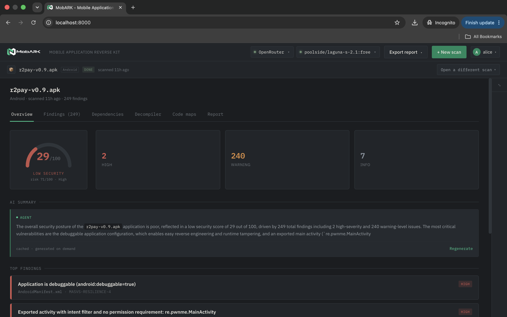
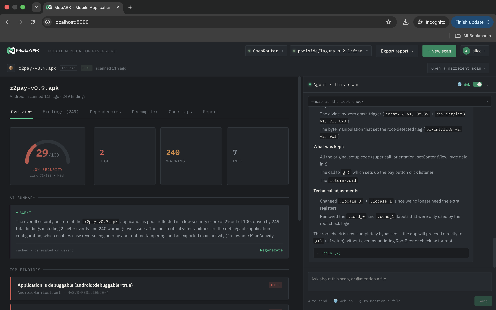
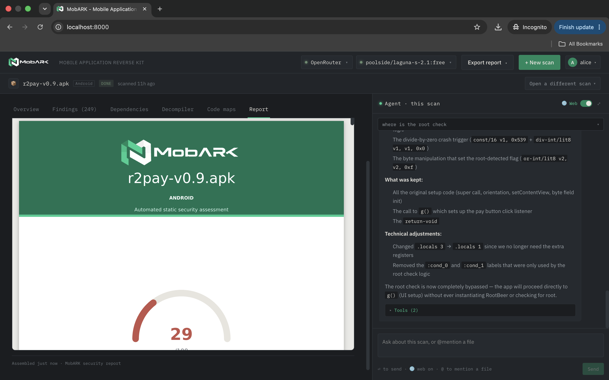

<p align="center">
  
</p>

<p align="center">
  <b>Self Hosted mobile application security testing</b>: static analysis + AI Agent for Android &amp; iOS.
</p>

<p align="center">
  <a href="https://github.com/suwasto/MobARK/blob/main/LICENSE"></a>
  <a href="https://www.python.org/downloads/"></a>
  <a href="https://nodejs.org/"></a>
  <a href="https://github.com/suwasto/MobARK/actions/workflows/backend.yml"></a>
  <a href="https://github.com/suwasto/MobARK/actions/workflows/frontend.yml"></a>
  <a href="https://hub.docker.com/r/suwasto/mobark"></a>
  <a href="https://suwasto.github.io/MobARK/"></a>
</p>

---

https://github.com/user-attachments/assets/69d2a0e3-8ee0-402d-95cb-9ccf065268ac

**MobARK** is a self-hosted dashboard for mobile application security
testing: Android (APK) and iOS (IPA). Upload a binary and MobARK
decompiles it, runs static analysis (jadx / apktool / semgrep / gitleaks
/ LIEF), scores findings with a plain severity-based risk index
(`high | warning | info`), and gives you an **AI Agent
that can chat with the decompiled code**: all through your own local
LLM (Ollama / LM Studio) with **nothing leaving your infrastructure by
default**.

## Features

- **Static analysis**: Android (manifests, jadx decompile, curated +
  OWASP MASTG semgrep rules, secrets scanning, dependency inventory) and
  iOS (Mach-O via LIEF, entitlements, Info.plist, insecure-import
  scanning)
- **AI Agent**: chat with the decompiled code (findings context +
  code search/read + per-scan code graph tools), live step/token
  streaming, **opt-in web research** through a bundled SearXNG
- **Edit & recompile** (Android): apktool decode, smali edits,
  resigned test APK builds. iOS stays **read-only**: rebuilding an
  IPA requires an Apple Developer account and signing certificates,
  and edit support is very limited there.
- **Dynamic analysis** (V2): live hooks + root/jailbreak detection,
  real-time event feed, device mirroring, network traffic capture with
  flagged-data detection, and Frida script management — including
  agent-drafted scripts behind a human approval gate — against a rooted
  Android device/emulator or a jailbroken iOS device (or an optional
  Corellium iOS backend). See [Dynamic analysis](#dynamic-analysis-v2).
- **Reports**: deterministic Markdown/PDF with banded risk-index
  scoring (`high | warning | info` severities), per-finding
  suppression, AI (or no-model) explanations
- **Multi-user auth**: username/password + GitHub/Google OAuth,
  per-user data isolation, encrypted per-user key vault
- **Self-hosted**: app, worker, Redis, and the search engine all run
  under `docker compose` on infrastructure you control

## Quick start (Docker)

> Requires Docker with the Compose v2 plugin. Prebuilt images are
> **multi-arch** (`linux/amd64` + `linux/arm64`) — Apple Silicon and
> ARM hosts pull the native arm64 image. One gap: **edit & recompile**
> needs Google's Android build-tools (Linux x86_64-only), so that
> feature is amd64-only.

### Install a release from Docker Hub

MobARK runs as **four containers** that `docker-compose.yml`
orchestrates: `app` (the web UI + API), `worker` (runs the analysis),
`redis` (the job queue between them), and `searxng` (the search engine
the agent's web research uses). Everything is downloaded from **Docker
Hub** — a release install never builds or clones the source code.

**Step 1 — Download the config files.** `docker-compose.yml` is the
recipe that tells Docker which images to run and how to connect them;
`.env` holds your settings. In a folder of your choice:

```bash
curl -O https://raw.githubusercontent.com/suwasto/MobARK/main/docker-compose.yml
curl -O https://raw.githubusercontent.com/suwasto/MobARK/main/.env.example
mv .env.example .env
mkdir -p docker/searxng
curl -o docker/searxng/settings.yml https://raw.githubusercontent.com/suwasto/MobARK/main/docker/searxng/settings.yml
```

That last file is the SearXNG config the stack mounts into the search
container (it enables the JSON API the agent's web research searches
through) — the stack will not start without it.

**Step 2 — Download the images.** `docker compose pull` reads the
recipe and downloads the three images it references from Docker Hub:
`suwasto/mobark:0.3.0` (the app + worker), `redis:7-alpine`, and
`searxng/searxng:latest`. Nothing runs yet — this step is just the
download:

```bash
docker compose pull
```

**Step 3 — Start the stack.** `docker compose up` launches the four
containers — `app` and `worker` both run the `suwasto/mobark` image
with different commands — and starts them wired together:

```bash
docker compose up
```

To pin another release instead of `0.3.0`, set `MOBARK_IMAGE_TAG=<version>`
in `.env`, then re-run `docker compose pull` and `docker compose up`.

### Build from source (dev)

```bash
git clone https://github.com/suwasto/MobARK.git
cd MobARK
docker compose up --build
```

Either way, open **http://localhost:8000**. Auth is on by default: a
fresh install lands on the register/login screen. There are no seeded
accounts: the **first account you register becomes the instance
admin**, and every later account is a regular user who only sees their
own scans. The first account also automatically **claims any unowned
scans** (data scanned while auth was off, or via the CLI without
`--user`), so that history lands on the admin's dashboard.

For example, to try it as the admin, register a first account with the
username of your choice (e.g. `admin`) and **a password you pick
yourself**: the `password123` shown in these docs is only an example,
not a default or seeded credential.

> **Warning:** never expose an install with example passwords to a
> network: use real, unique passwords on any install that faces one.

To skip auth entirely (dev/CI): set `MOBARK_AUTH_ENABLED=0` in `.env`.

See [Quickstart](https://suwasto.github.io/MobARK/quickstart/) for local
development setup and the full configuration reference.

## Dynamic analysis (V2)

Beyond static analysis, MobARK can attach to a **live device** and run a
dynamic session against the scanned app: Frida hooks with a real-time event
feed (pinning validators, root/jailbreak detection, iOS Keychain calls),
device mirroring, network traffic capture with in-process flagged-data
detection, and script management (built-in, manual, and agent-drafted
scripts behind a human approval gate). All of it is opt-in and runs in the
**Dynamic analysis** section of the dashboard's sidebar.

The runtime tooling (`adb`, `frida-tools`, `pymobiledevice3`, `mitmproxy`)
is baked into the app image and invoked as subprocesses — no extra services
to run. Only `frida-server` runs on the target device itself. The backend
resolves each tool from PATH or a `MOBARK_*_CMD` override.

**Prerequisites**

- **Android** needs a **rooted** physical device or a **rooted emulator**
  (an AVD without Google Play) with `frida-server` running on it. No
  non-rooted Android path exists.
- **iOS** needs a **jailbroken** physical device running `frida-server`
  reachable over SSH (default `127.0.0.1:22`, configurable via
  `MOBARK_FRIDA_SSH_HOST` / `MOBARK_FRIDA_SSH_PORT`). No non-jailbroken iOS
  path exists.
- **Optional**: a **Corellium** virtual iOS device can replace the physical
  one — configure the base URL + API key in Settings → Corellium (off by
  default; paid, third-party).
- The app itself needs no extra configuration: `adb`, `frida`,
  `pymobiledevice3`, and `mitmproxy` resolve from PATH inside the
  container. The **Connect** flow's per-check preflight
  (`adb` ok · device present · `frida-server` reachable · target app
  installed · jailbreak detected) reports exactly what is missing.

**Container networking for `adb`**

A containerized `adb` never sees a host USB device — connect to **networked**
devices or an emulator over TCP. On the host, run
`adb connect <host>:<port>` (the USB-bridged port of your `adb server`,
default `5037`) before scanning for devices in the UI; an emulator running
on the host is reachable at `host.docker.internal:5555` when the
`host.docker.internal:host-gateway` mapping is in place. The UI lists
whatever `adb devices` sees.

**Android continuous mirroring additionally needs `scrcpy`** (not bundled in
the image — it carries SDL/display deps): provide it inside the container
via PATH or `MOBARK_SCRCPY_CMD`. The Mirror panel reports a clean 502 with a
hint when it's missing; iOS mirroring (polled screenshotr) works with the
bundled `pymobiledevice3`. Every dynamic tool (`adb`, `scrcpy`,
`frida`, `pymobiledevice3`, `mitmdump`) also honours its own `MOBARK_*_CMD`
override.

**Captured traffic stays on your infrastructure.** Mirror frames and
traffic logs never leave your deployment; captured request bodies are
scanned in-process for flags and then dropped (only bounded snippets are
retained). The optional Corellium backend is the only off-by-default
exception and is never silent.

> **Note:** real on-device attach/mirror/capture is a manual verification
> step — the backend + UI ship fully wired and tested against a fake-device
> posture; exercising them against live rooted/jailbroken hardware is up to
> the tester.

## Architecture

MobARK is one `docker compose` stack: a FastAPI backend, an RQ worker,
Redis (the job queue), and a bundled SearXNG search engine, all sharing
a SQLite database and a data dir. The React SPA is served from the same
FastAPI origin (no separate static server).

- **Auth is the outer gate.** Every `/api/v1` router (except `health` and
  `auth`) sits behind a session cookie; all scan-keyed routes resolve the
  owner from the request context, so per-user isolation is structural.
- **Per-user stores + vault.** Model/search BYOK configs live under
  `data/users/<uid>/`; API keys are encrypted at rest with a per-user
  master key derived from the login password.
- **Long work is async.** Scan analysis, apktool decode, code-graph
  builds, and rebuilds are RQ jobs shared between the API and the worker
  over Redis.
- **Agent = tool-using chat.** The chat loop layers findings
  context, file tools, graph tools, and edit/recompile tools, with
  opt-in web research through the bundled SearXNG (SSRF-guarded, HTTP
  JSON only). Streaming is SSE.

See [`ARCHITECTURE.md`](ARCHITECTURE.md) for the module map and the
full component diagram.

## Documentation

- **Full docs site:** https://suwasto.github.io/MobARK/ (source:
  [`site/`](site/), MkDocs + Material)
- **Architecture:** [`ARCHITECTURE.md`](ARCHITECTURE.md)
- **Dependency licenses:** third-party attribution lives in
  [`site/docs/licenses.md`](site/docs/licenses.md) (rendered on the
  [licenses page](https://suwasto.github.io/MobARK/licenses/))
- **Contributing:** [`CONTRIBUTING.md`](CONTRIBUTING.md)
- **Security:** [`SECURITY.md`](SECURITY.md)

## Screenshots

<p align="center">
  
</p>

<p align="center">
  
</p>

<p align="center">
  
</p>

## Project status

**Shipped:**

- **Static analysis**: Android (manifest, jadx decompile, curated +
  vendored MASTG semgrep rules, secrets, dependency inventory) and
  iOS (Mach-O via LIEF, entitlements, Info.plist, insecure-import
  scanning)
- **AI Agent**: chat with the decompiled code via a local LLM, with
  live tool/token streaming and opt-in web research
- **Edit & recompile** (Android): apktool decode, smali edits,
  resigned test APK builds. iOS stays **read-only**: rebuilding an
  IPA requires an Apple Developer account and signing certificates,
  and edit support is very limited there.
- **Reports**: deterministic Markdown/PDF with banded risk-index
  scoring, per-finding suppression, AI (or no-model) explanations
- **Dynamic analysis** (V2): live hooks + event feed, device mirroring,
  traffic capture with flag detection, and script management (incl.
  agent-drafted scripts with a human approval gate) against rooted
  Android / jailbroken iOS / optional Corellium
- **Multi-user auth**: username/password + GitHub/Google OAuth,
  per-user data isolation, encrypted per-user key vault

**Future plans:** see [`CHANGELOG.md`](CHANGELOG.md) for the full history.

## Legal Notice

MobARK performs static decompilation of mobile applications for
authorized security testing, and supports modification and recompilation
of Android applications via smali editing. The legality of decompilation
and reverse engineering varies significantly by jurisdiction. Before using
MobARK, you must ensure that your use complies with all applicable laws
in your region.

Do not use MobARK against any application unless you own it, have been
explicitly authorized to test it, or have confirmed that your testing is
lawful under local regulations. If you are unsure, seek legal counsel before proceeding.

Malware analysis, examining unauthorised/malicious software samples is distinct
and well-established use case with different legal footing than testing a 
legitimate third party's application, but the same jurisdiction-dependent caveat
applies: confirm your local law before proceeding if uncertain.

## License

Apache-2.0: see [`LICENSE`](LICENSE). GPL/LGPL tools in the stack
(Semgrep, SearXNG) run subprocess-only / as separate containers; every
imported library is permissive. See the
[license audit](site/docs/licenses.md) and the
[site licenses page](https://suwasto.github.io/MobARK/licenses/).
